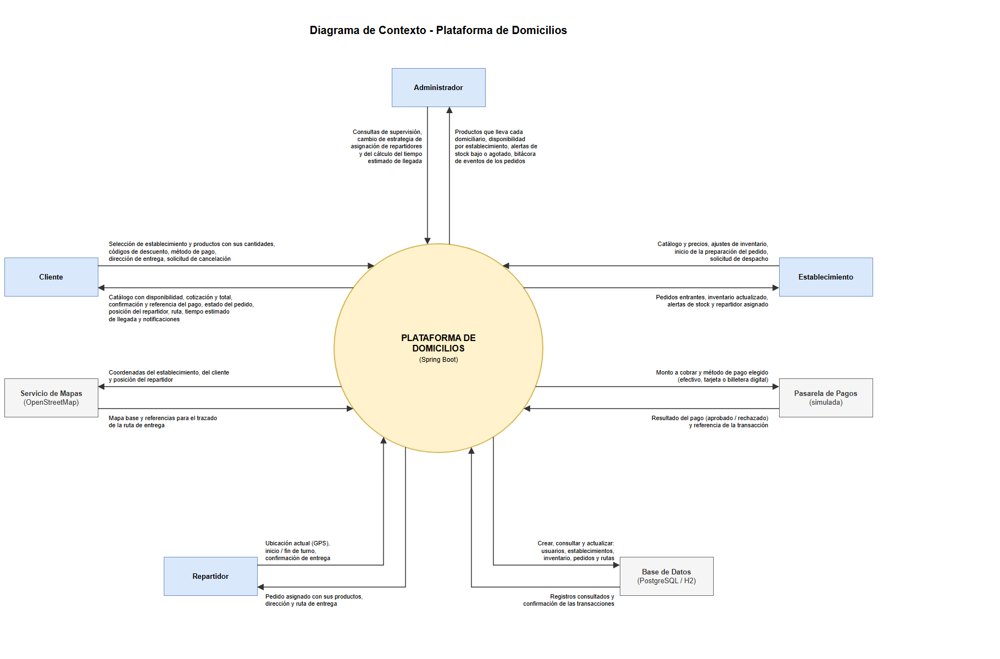
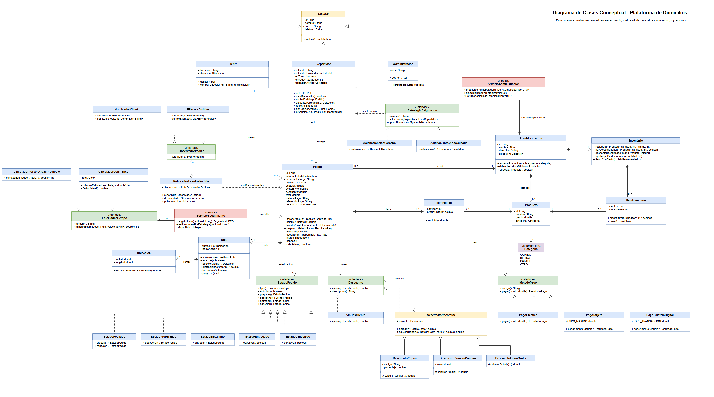
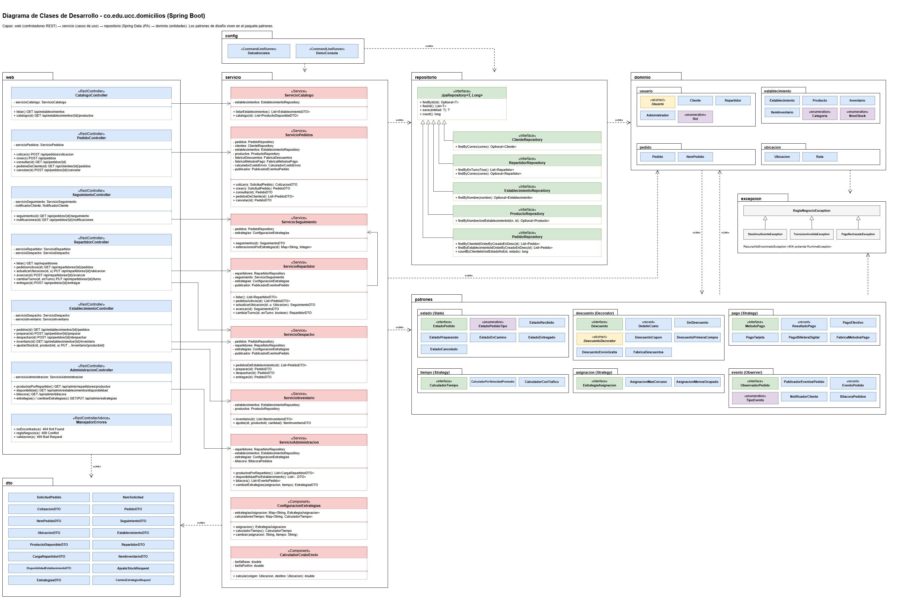
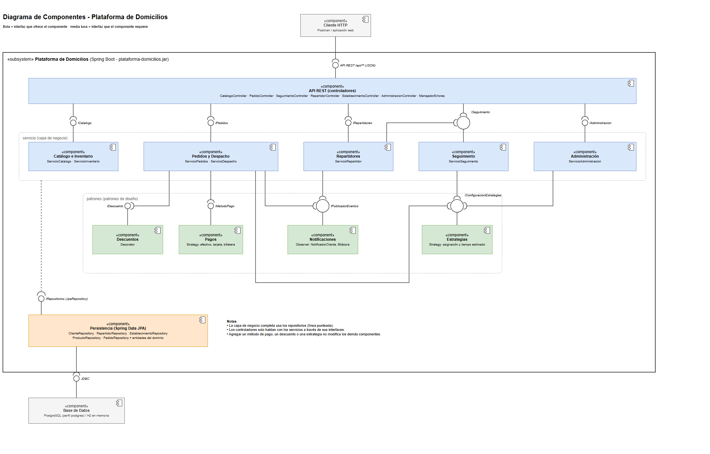
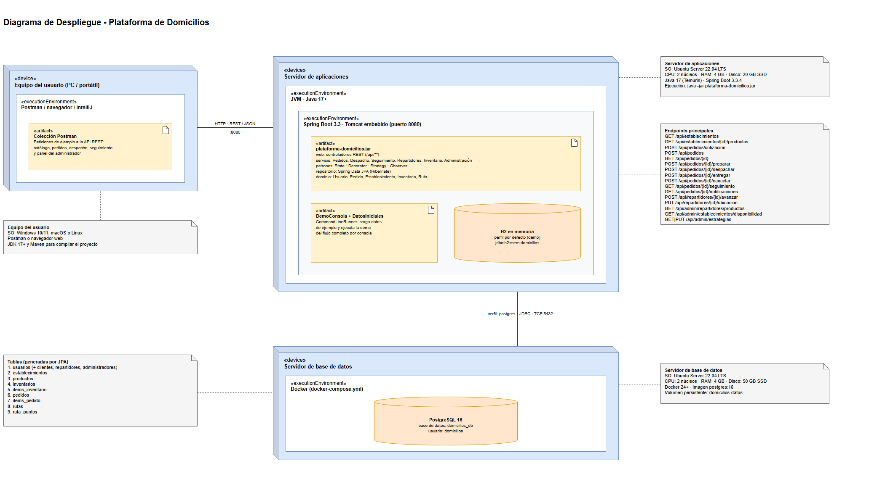

# Plataforma de Domicilios

Proyecto final de Programación Orientada a Objetos: una API REST en **Spring Boot 3** que gestiona pedidos, inventario por establecimiento y seguimiento de entregas. Incluye una **demo por consola** que se ejecuta desde el `main` y recorre el flujo completo de un pedido.

> Universidad Cooperativa de Colombia · Ingeniería de Software · Octubre de 2026

---

## 1. Plan de trabajo

El plan sigue las fases de la propuesta (`Propuesta_Proyecto_Final_Plataforma_Domicilios.docx`).

| Fase | Entregable | Estado | Dónde está |
|------|------------|--------|------------|
| **1 · Núcleo** | Usuarios por rol, establecimientos, productos, pedidos con estados, descuentos y métodos de pago | Hecho | `dominio/`, `patrones/estado`, `patrones/descuento`, `patrones/pago` |
| **2 · Inventario y administración** | Inventario por establecimiento, productos por domiciliario, disponibilidad con alertas | Hecho | `Inventario`, `ServicioAdministracion`, `AdministracionController` |
| **3 · Seguimiento** | Ubicación del repartidor, ruta y tiempo estimado de llegada | Hecho (ruta simulada) | `Ruta`, `ServicioSeguimiento`, `patrones/tiempo` |
| **4 · Mejoras** | Asignación inteligente del repartidor, bitácora de eventos | Hecho | `patrones/asignacion`, `BitacoraPedidos` |
| Pendiente | Calificaciones, autenticación con JWT, mapa web con Leaflet | Trabajo futuro | — |

Como propone el documento para la versión académica, la ubicación del repartidor se simula con los puntos de una ruta predefinida.

---

## 2. Cómo ejecutarlo

**Requisitos:** JDK 17 o superior (la propuesta menciona Java 21 y también funciona) y Maven 3.9+.

```bash
mvn spring-boot:run
```

En IntelliJ IDEA basta con abrir la carpeta y ejecutar `DomiciliosApplication.main()`.

Al iniciar, la aplicación:

1. Carga datos de ejemplo en una base H2 en memoria (`config/DatosIniciales.java`).
2. Imprime la **demo por consola** (`config/DemoConsola.java`).
3. Deja la API REST activa en `http://localhost:8080/api` para probarla con Postman.

Extracto de la salida de la demo:

```
 PASO 2. Carlos arma su pedido y aplica descuentos apilados (patrón Decorator)
   Códigos: BIENVENIDA + ENVIOGRATIS + DOMI10
   Subtotal productos ........      $74.000
   Domicilio (1.43 km) ........       $4.700
   Descuentos ................     -$17.100
   TOTAL .....................      $61.600

 PASO 5. Ciclo de vida del pedido (patrón State)
   [RECHAZADO] Entregar un pedido que apenas fue RECIBIDO
               -> No se puede entregar un pedido en estado RECIBIDO

 PASO 8. Seguimiento en tiempo real: el repartidor avanza por la ruta (Observer + Strategy ETA)
   [Notificación al cliente] Hola Carlos Pérez, tu pedido #3: el repartidor está a 1.03 km, llega en ~3 min (40% del recorrido)
```

Otros comandos:

```bash
mvn test
```

```bash
docker compose up -d
```

```bash
mvn spring-boot:run -Dspring-boot.run.profiles=postgres
```

- `mvn test` ejecuta las 16 pruebas: unitarias del dominio y de los patrones, y una de integración del flujo completo.
- Los dos últimos comandos usan PostgreSQL en lugar de H2: el primero levanta la base de datos y el segundo arranca la aplicación con el perfil `postgres`.
- Para desactivar la demo por consola, ponga `domicilios.demo.consola=false` en `application.properties`.
- Si las tildes salen mal en la terminal de Windows, ejecute `chcp 65001` antes de iniciar.

### Probar con Postman

Importe `docs/postman/PlataformaDomicilios.postman_collection.json` y ejecute las carpetas en orden:

1. Catálogo
2. Cliente: pedido
3. Establecimiento
4. Repartidor y seguimiento
5. Administrador

La colección guarda automáticamente el `pedidoId` y el `repartidorId`.

**Datos de ejemplo:**

| Tipo | Datos |
|------|-------|
| Establecimientos | 1 = La Esquina Burger · 2 = Pizzería Napoli · 3 = Dulce Aroma Café |
| Clientes | 1 = Ana Gómez (ya tiene compras) · 2 = Carlos Pérez (cliente nuevo) |
| Repartidores | 3 = Pedro (moto) · 4 = Laura (bicicleta) · 5 = Andrés (moto) · 6 = Sofía (fuera de turno) |
| Cupones | `BIENVENIDA` (primera compra, -$5.000) · `ENVIOGRATIS` (desde $40.000) · `DOMI10` · `DOMI20` |
| Métodos de pago | `EFECTIVO` · `TARJETA` · `BILLETERA` |

---

## 3. Endpoints

| Rol | Método y ruta | Qué hace |
|-----|---------------|----------|
| Cliente | `GET /api/establecimientos` | Lista los establecimientos |
| Cliente | `GET /api/establecimientos/{id}/productos` | Catálogo con existencias y nivel de stock |
| Cliente | `POST /api/pedidos/cotizacion` | Calcula el total con domicilio y descuentos sin crear el pedido |
| Cliente | `POST /api/pedidos` | Crea el pedido: verifica stock, aplica descuentos y paga |
| Cliente | `GET /api/pedidos/{id}` · `GET /api/clientes/{id}/pedidos` | Consulta pedidos |
| Cliente | `POST /api/pedidos/{id}/cancelar` | Cancela (solo si está RECIBIDO) |
| Cliente | `GET /api/pedidos/{id}/seguimiento` | Posición del repartidor, ruta recorrida y restante, distancia y tiempo estimado |
| Cliente | `GET /api/pedidos/{id}/notificaciones` | Avisos recibidos (Observer) |
| Establecimiento | `GET /api/establecimientos/{id}/pedidos` | Pedidos entrantes |
| Establecimiento | `POST /api/pedidos/{id}/preparar` | Empieza la preparación y descuenta el inventario |
| Establecimiento | `POST /api/pedidos/{id}/despachar` | Asigna repartidor (Strategy) y traza la ruta |
| Establecimiento | `GET /api/establecimientos/{id}/inventario` · `PUT .../inventario/{productoId}` | Consulta y ajusta existencias |
| Repartidor | `GET /api/repartidores` · `GET /api/repartidores/{id}/pedidos` | Repartidores y sus pedidos activos |
| Repartidor | `POST /api/repartidores/{id}/avanzar` | Simula que avanza un tramo (~150 m) de la ruta |
| Repartidor | `PUT /api/repartidores/{id}/ubicacion` | Reporta su posición GPS |
| Repartidor | `PUT /api/repartidores/{id}/turno?enTurno=` | Inicia o termina turno |
| Repartidor | `POST /api/pedidos/{id}/entregar` | Marca el pedido como entregado |
| Administrador | `GET /api/admin/repartidores/productos` | Qué productos lleva cada domiciliario |
| Administrador | `GET /api/admin/establecimientos/disponibilidad` | Inventario por establecimiento con alertas |
| Administrador | `GET /api/admin/bitacora` | Últimos eventos de los pedidos |
| Administrador | `GET` / `PUT /api/admin/estrategias` | Ver o cambiar la estrategia de asignación y de tiempo estimado |

---

## 4. Estructura del código

```
src/main/java/co/edu/ucc/domicilios
├── DomiciliosApplication.java      ← main
├── config/          DatosIniciales (datos de ejemplo) · DemoConsola (demo por consola)
├── web/             Controladores REST + ManejadorErrores
├── servicio/        Casos de uso: Catalogo, Pedidos, Despacho, Seguimiento, Repartidor, Inventario, Administracion
├── repositorio/     Interfaces Spring Data JPA
├── dto/             Objetos de entrada/salida de la API (records)
├── dominio/
│   ├── usuario/         Usuario (abstracta) → Cliente, Administrador, Repartidor
│   ├── establecimiento/ Establecimiento, Producto, Inventario, ItemInventario
│   ├── pedido/          Pedido, ItemPedido
│   └── ubicacion/       Ubicacion, Ruta
├── patrones/
│   ├── estado/      State: EstadoPedido + Recibido, Preparando, EnCamino, Entregado, Cancelado
│   ├── descuento/   Decorator: Descuento, DescuentoDecorator, Cupon, PrimeraCompra, EnvioGratis
│   ├── pago/        Strategy/polimorfismo: MetodoPago + Efectivo, Tarjeta, BilleteraDigital
│   ├── tiempo/      Strategy: CalculadorTiempo + VelocidadPromedio, ConTrafico
│   ├── asignacion/  Strategy: EstrategiaAsignacion + MasCercano, MenosOcupado
│   └── evento/      Observer: PublicadorEventosPedido, ObservadorPedido, NotificadorCliente, BitacoraPedidos
└── excepcion/       Excepciones del negocio
```

---

## 5. POO, SOLID y patrones aplicados

| Concepto | Dónde se ve |
|----------|-------------|
| **Abstracción** | `Usuario` (abstracta), interfaces `MetodoPago`, `Descuento`, `EstadoPedido`, `CalculadorTiempo` |
| **Herencia** | `Cliente`, `Administrador` y `Repartidor` extienden `Usuario`; los descuentos extienden `DescuentoDecorator` |
| **Polimorfismo** | `Pedido.pagar(MetodoPago)` y `Pedido.liquidar(Descuento)` no saben qué implementación reciben; `getRol()` responde según la subclase |
| **Encapsulamiento** | El estado del pedido solo cambia con `iniciarPreparacion()`, `despachar()`, `marcarEntregado()`, `cancelar()`; el stock solo cambia con `Inventario.descontar()` / `ajustar()`, que nunca deja cantidades negativas |
| **Composición** | `Pedido` contiene `ItemPedido` y `Ruta`; `Establecimiento` contiene `Inventario`; `Ruta` contiene `Ubicacion` |
| **Responsabilidad única** | Cada servicio atiende un grupo de casos de uso; `Inventario` solo maneja existencias |
| **Abierto/cerrado** | Un método de pago nuevo es una clase con `@Component` que implementa `MetodoPago`: `FabricaMetodosPago` la encuentra sola |
| **Liskov** | Cualquier `Descuento`, `MetodoPago` o `EstrategiaAsignacion` reemplaza a otro sin romper el flujo |
| **Segregación de interfaces** | Interfaces pequeñas: `ObservadorPedido` tiene un solo método |
| **Inversión de dependencias** | `Pedido` depende de interfaces; los servicios reciben sus dependencias por constructor (Spring) |
| **State** | `patrones/estado`: cada estado decide qué transición es válida |
| **Decorator** | `patrones/descuento`: los descuentos se apilan, por ejemplo `EnvioGratis(Cupon(PrimeraCompra(SinDescuento)))` |
| **Strategy** | `patrones/asignacion` y `patrones/tiempo`, intercambiables en caliente desde `/api/admin/estrategias` |
| **Observer** | `patrones/evento`: el cliente y la bitácora se enteran de cada cambio de estado y de ubicación |

Fórmula del total (sección 5.3 de la propuesta):
`total = suma de productos + costo del domicilio (tarifa base + tarifa × km) − descuentos`.

---

## 6. Diagramas

En `docs/diagramas/` hay un `.drawio` (editable en [draw.io](https://app.diagrams.net)) y un `.png` de cada diagrama. Todas las líneas son ortogonales, ninguna se cruza ni se toca con otra, y ninguna atraviesa una caja.

| # | Diagrama | Archivo |
|---|----------|---------|
| 1 | Contexto | `01-diagrama-contexto.drawio` |
| 2 | Clases (conceptual) | `02-diagrama-clases-conceptual.drawio` |
| 3 | Clases (desarrollo) | `03-diagrama-clases-desarrollo.drawio` |
| 4 | Componentes | `04-diagrama-componentes.drawio` |
| 5 | Despliegue | `05-diagrama-despliegue.drawio` |






